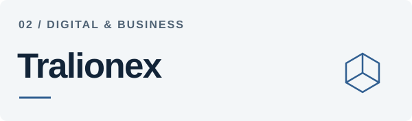
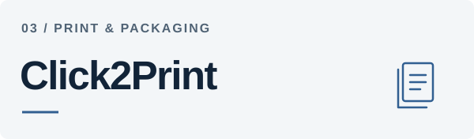

<a href="https://iqx.world/">
  <picture>
    <source media="(max-width: 600px) and (prefers-color-scheme: dark)" srcset="./assets/iqx-profile-mobile-dark.svg" />
    <source media="(max-width: 600px)" srcset="./assets/iqx-profile-mobile.svg" />
    <source media="(prefers-color-scheme: dark)" srcset="./assets/iqx-profile-banner-dark.svg" />
    
  </picture>
</a>

# IQX Solutions

**We bring thoughtful design and practical engineering to business websites.**

Based in **Lahore, Pakistan**, we work remotely with **UK businesses** on websites, e-commerce, SEO, and ongoing digital support.

  
  &nbsp;
  

## Our work

### IQX · Web & digital

Our main focus: custom websites, redesigns, landing pages, online stores, search foundations, and support after launch. Clear structure, considered interfaces, and content people can find and understand.

[Explore services →](https://iqx.world/services) &nbsp; · &nbsp; [How we work](https://iqx.world/approach)

<table>
  <tr>
    <td width="50%" valign="top">
      <a href="https://tralionex.pk/">
        <picture>
          <source media="(prefers-color-scheme: dark)" srcset="./assets/tralionex-card-dark.svg" />
          
        </picture>
      </a>
      
<strong>Tralionex</strong> Our secondary brand for websites, digital marketing, branding, portals, and business systems across Pakistan.

      
<a href="https://tralionex.pk/">tralionex.pk ↗</a>

    </td>
    <td width="50%" valign="top">
      <a href="https://click2print.pk/">
        <picture>
          <source media="(prefers-color-scheme: dark)" srcset="./assets/click2print-card-dark.svg" />
          
        </picture>
      </a>
      
<strong>Click2Print</strong> Custom printing, packaging, labels, stationery, and brand materials, coordinated from Lahore.

      
<a href="https://click2print.pk/">click2print.pk ↗</a>

    </td>
  </tr>
</table>

## Engineering with intent

- **Readable from the first request.** Static prerendering gives search engines and AI crawlers real HTML, clear headings, and structured content.
- **Designed for everyday use.** Responsive layouts, accessible interfaces, and straightforward journeys.
- **Built for handover.** Agreed scope, practical reviews, and clear access and support arrangements.

**Our IQX toolkit** &nbsp; React · Vite · Tailwind CSS · Motion · React Router · Node.js

## Let's talk

Tell us what you're building, what needs improving, and the outcome you have in mind.

**[Discuss your project →](https://iqx.world/contact)** &nbsp; · &nbsp; [Email](mailto:iqx.world@gmail.com) &nbsp; · &nbsp; [WhatsApp](https://wa.me/923363333891)

Lahore, Pakistan · UK projects delivered remotely · iqx.world@gmail.com
