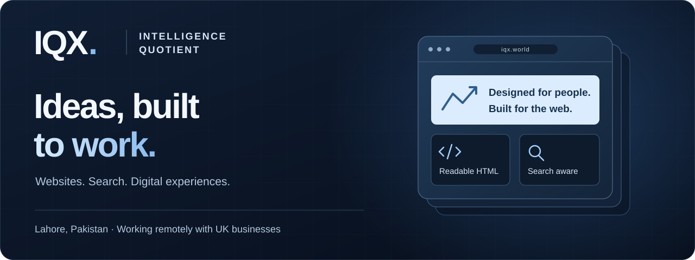
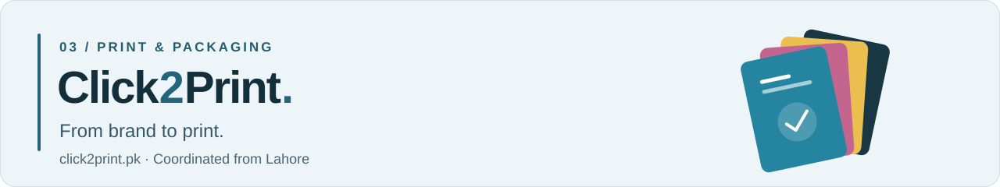

# IQX Solutions · Intelligence Quotient

**Thoughtful design. Practical development. A clearer digital presence.**

We build websites, improve search foundations, and support businesses after launch. IQX is our primary brand, based in Lahore, Pakistan, and working remotely with UK businesses. This profile brings together our work across **IQX**, **Tralionex**, and **Click2Print**.

**[Visit IQX ↗](https://iqx.world/)** &nbsp; · &nbsp; [Discuss a project](https://iqx.world/contact) &nbsp; · &nbsp; [Email us](mailto:iqx.world@gmail.com)

[Our brands](#our-brands) &nbsp; / &nbsp; [What we do](#what-we-do) &nbsp; / &nbsp; [How we build](#how-we-build) &nbsp; / &nbsp; [Get in touch](#get-in-touch)

---

## Our brands

### 01 / IQX — Our primary focus

**Websites people can use. Content search engines can read.**

Custom websites, redesigns, e-commerce, SEO, and ongoing website support for UK businesses. We connect clear page structure, responsive design, and practical development with an agreed scope and a clear handover.

- **Web design & development** — Business websites, redesigns, and focused landing pages.
- **Search foundations** — Technical SEO, on-page structure, local SEO, and Google Business Profile support.
- **E-commerce** — Online stores, Shopify development, and customer journeys.
- **Ongoing support** — Hosting, maintenance, updates, and technical improvements.

**[Explore IQX →](https://iqx.world/)** &nbsp; · &nbsp; [Services](https://iqx.world/services) &nbsp; · &nbsp; [Our approach](https://iqx.world/approach)

### 02 / Tralionex — Our secondary brand

Website development, branding, digital marketing, web portals, dashboards, and business automation for businesses in Lahore and across Pakistan. Tralionex connects a business's online presence with the systems behind its everyday work.

**[Explore Tralionex →](https://tralionex.pk/)** &nbsp; · &nbsp; [Discuss a project](https://tralionex.pk/contact/)

### 03 / Click2Print — Print & packaging

Custom printing, packaging, and branding coordinated from Lahore. Business cards, brochures, stickers, labels, certificates, signage, corporate materials, and thesis printing and binding, with delivery options across Pakistan.

**[Explore Click2Print →](https://click2print.pk/)**

---

## What we do

| Focus | The work |
| :--- | :--- |
| **Web experiences** | Responsive websites, landing pages, redesigns, and e-commerce. |
| **Search & discovery** | Technical SEO, readable HTML, metadata, structured data, sitemaps, and clear service content. |
| **Business systems** | Web portals, dashboards, and workflow automation through Tralionex. |
| **Brand & communication** | Brand identity, digital marketing, and coordinated visual communication. |
| **Print & packaging** | Physical brand materials and custom production through Click2Print. |

## How we build

**Clear scope → Considered design → Practical development → Review & handover**

We agree the pages, features, responsibilities, and review points before the build. We design for mobile and desktop, check the agreed functionality, and explain access and ongoing support at handover.

For the IQX website, our toolkit includes **React · Vite · Tailwind CSS · Motion · React Router · Node.js**.

Our website build uses **static prerendering** to deliver real HTML before JavaScript runs. Headings, service content, links, image descriptions, FAQs, and structured data belong in the delivered page. Clear answers and consistent business information also help search engines and AI assistants understand the site.

[See the IQX approach →](https://iqx.world/approach)

## A few quick answers

<strong>Which brand should I contact?</strong>

Start with [IQX](https://iqx.world/contact) for websites, SEO, e-commerce, and ongoing support for a UK business. Visit [Tralionex](https://tralionex.pk/contact/) for websites, marketing, and business systems in Pakistan, or [Click2Print](https://click2print.pk/) for printing and packaging.

<strong>Where are you based?</strong>

We are based in Lahore, Pakistan. IQX works remotely with UK businesses; Tralionex supports businesses across Pakistan. Click2Print coordinates production from Lahore, with delivery options depending on the order and destination.

<strong>What should I include in a project enquiry?</strong>

Share your business, current website if you have one, what you need, and your preferred timing. For printing, include the product, size, quantity, artwork status, and delivery city. Scope, pricing, and timing are confirmed after review.

---

## Get in touch

**Have a website to build, a business to improve, or a brand to bring to life?**

[Start with IQX →](https://iqx.world/contact) &nbsp; · &nbsp; [WhatsApp](https://wa.me/923363333891) &nbsp; · &nbsp; [iqx.world@gmail.com](mailto:iqx.world@gmail.com)

Lahore, Pakistan &nbsp; · &nbsp; UK projects delivered remotely &nbsp; · &nbsp; +92 336 3333891

  <a href="https://iqx.world/">IQX</a> &nbsp; / &nbsp; <a href="https://tralionex.pk/">Tralionex</a> &nbsp; / &nbsp; <a href="https://click2print.pk/">Click2Print</a> Design with purpose. Build with care.

